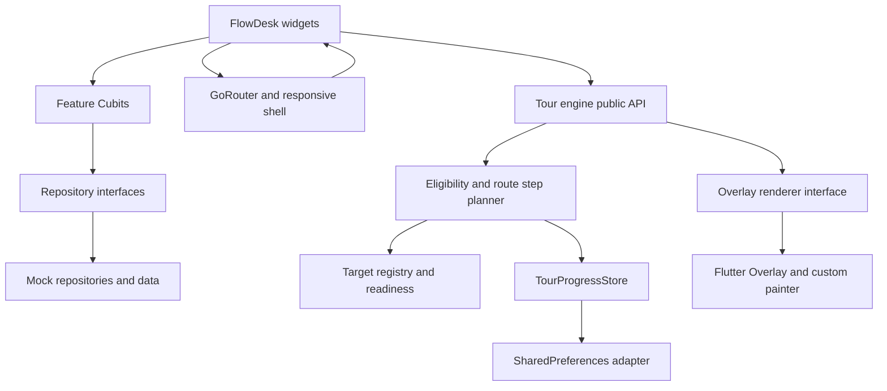

# Phase 2 — FlowDesk architecture and design system

**Status:** Finalized for Phase 3 implementation  
**Date:** 12 November 2026  
**Basis:** Phase 1 package research and the project brief. The existing `dynamic_tour_engine` package is an earlier engine/demo implementation; this document defines the target architecture for the FlowDesk application and the boundaries that implementation should follow.

## Decisions

1. **Application shape:** FlowDesk is a single Flutter Web application with a responsive app shell and independently routable feature modules. Use GoRouter for URL and browser history behavior, Bloc/Cubit at feature boundaries, and repository interfaces for mock data.
2. **Tour ownership:** The reusable engine owns configuration, eligibility, step planning, target readiness, cross-route progress and presentation state. FlowDesk owns route navigation, signed-in user context and initial local persistence wiring.
3. **Rendering:** Keep spotlight geometry and tooltip rendering behind an engine-owned renderer/overlay boundary. Do not place package-specific target classes in public configuration. The Phase 1 package comparison did not identify a complete orchestration fit.
4. **Target IDs:** Use stable, namespaced strings such as `dashboard.analytics`, `users.table`, and `reports.export`. IDs identify semantic UI targets, not widget instances. Each mounted target registers and unregisters through lifecycle-aware anchors.
5. **Persistence:** Define an async `TourProgressStore` port. Start with SharedPreferences for demo state. Completion, skip and resume are separate states; manual restart clears the selected tour's progress before beginning.
6. **Responsive design:** Desktop uses a collapsible sidebar; compact widths use a drawer/sheet. Cards, tables and filters must reflow or switch presentation rather than overflow. The overlay recalculates placement after resize and scroll.

## Application architecture



### Single-project layout for FlowDesk

```text
lib/
  main.dart
  demo_store.dart
  dynamic_tour_engine.dart
test/
  tour_engine_test.dart
  widget_test.dart
web/
android/
```

The app and reusable engine live in the same Flutter project. `dynamic_tour_engine.dart` contains the engine API, while `main.dart` and `demo_store.dart` contain FlowDesk demo UI and state. Other projects can reuse this project through a local path or Git dependency.

### Dependency direction

- Widgets may depend on their feature Cubit and shared design components.
- Cubits may depend on repository interfaces, never on widgets or mock implementation classes.
- Mock repositories implement the same interfaces intended for future services.
- Tour configuration may refer to route strings, target IDs, role/permission names and named condition keys. It must not import feature Cubits or repositories.
- The route adapter invokes `TourController.handleRouteChanged()` after GoRouter changes. The controller asks the app-supplied navigator to move to a step's route.
- The engine core remains Flutter UI aware only at its rendering/target boundary; it must not depend on FlowDesk feature code.

## Route plan

| Route | Module | Independent tour target examples |
|---|---|---|
| `/dashboard` | Dashboard | `dashboard.metrics`, `dashboard.revenue`, `dashboard.activity`, `dashboard.quick_actions` |
| `/users` | User Management | `users.search`, `users.filters`, `users.table`, `users.add`, `users.row_actions` |
| `/alumni` | Alumni | `alumni.directory`, `alumni.filters`, `alumni.profile` |
| `/messages` | Messages | `messages.conversations`, `messages.composer`, `messages.details` |
| `/events` | Events | `events.view_switcher`, `events.filters`, `events.create` |
| `/reports` | Reports | `reports.date_range`, `reports.charts`, `reports.export` |
| `/notifications` | Notifications | `notifications.list`, `notifications.preferences` |
| `/settings` | Settings | `settings.sections`, `settings.permissions`, `settings.save` |
| `/profile` | Profile | `profile.completion`, `profile.edit`, `profile.security` |

Every route must load directly, survive refresh, and work with browser back/forward. Route tours are individually startable. The cross-page tour is registered separately and can jump between its configured routes; it never becomes a prerequisite for other routes.

## Tour engine contracts

### Configuration

- `TourConfiguration`: stable ID, title, ordered steps, welcome behavior, route-transition policy and presentation defaults.
- `TourStep`: stable step ID, route, target ID, copy, preferred tooltip placement, role/permission requirements, optional named predicate, and missing-target policy/timeout.
- Eligibility filters steps against an immutable user-context snapshot at start/resume. If eligibility changes during a tour, pause and re-plan at a documented boundary rather than mutating the displayed list mid-frame.
- Validate duplicate tour IDs and duplicate step IDs at registration/config-load time. Configuration errors should be surfaced as developer-facing errors in debug builds and a recoverable tour failure in release builds.

### Target registry and lifecycle

- A target anchor registers a semantic ID with a unique registration token and current target geometry source; disposal unregisters only that token, so an old instance cannot unregister a newer replacement.
- The registry exposes mounted/readiness lookup and change notifications. A target is ready only when it has a mounted render context with usable size and geometry.
- For scrollables, resolve the target's nearest scrollable and request visibility before measuring final geometry. Re-measure after scroll and after a frame.
- Delayed/conditional widgets may register later. Missing-target policies are `wait`, `skip`, `fallback`, or `cancel`, with bounded timeout/retry. Required steps default to wait then fail/pause; optional steps may skip.
- On target disposal, route departure or resize, hide stale geometry and re-resolve. Never retain a render object across frames as authoritative geometry.

### Navigation and persistence

- Navigation is an injected `Future<void> Function(String route)`; the engine does not own GoRouter.
- Route changes pause target presentation while loading, then wait for the destination target registry event and only resume after fresh layout geometry exists.
- Persist tour ID, current step ID, status, and update time. Do not persist widget keys, render objects, geometry or app-specific user data.
- A resume only applies if saved tour and step still exist after configuration and eligibility filtering. Otherwise start at the first eligible step with a recoverable notice.
- `SharedPreferences` is a demo adapter, not authoritative security or account storage. The async store interface supports replacing it with an API-backed implementation.

### State model

```text
idle -> welcome -> loading -> active
active -> loading (next/previous/route handoff)
active -> paused (user pause, route unavailable, target recovery)
active -> completed | skipped | cancelled | failed
paused -> loading | cancelled
```

All controls are idempotent: rapid repeated next/skip/close cannot advance or persist multiple conflicting transitions. Cubit/controller is disposed at the application boundary.

## FlowDesk design system

### Brand and tokens

- **Product character:** calm, capable, data-forward operations workspace. Strong information hierarchy, restrained color and clear actions.
- **Primary:** deep teal `#0B6B59`; hover `#085646`; soft tint `#E7F4F0`.
- **Accent:** vivid mint `#38CFA6` for selected navigation and tour spotlight accents, used sparingly.
- **Neutrals:** page `#F5F7FA`; surface `#FFFFFF`; elevated surface `#FFFFFF`; text `#17212B`; secondary text `#647180`; border `#E3E8EF`.
- **Semantic:** success `#17845B`, warning `#B96B12`, error `#C33D4B`, info `#3574C5`; pair each color with icon/text so meaning is not color-only.
- **Dark theme:** page `#10161D`; surface `#18212B`; elevated `#202B36`; text `#F0F4F7`; secondary `#A8B4C0`; border `#2E3B48`. Maintain semantic hues with contrast-adjusted variants.
- **Typography:** use a system sans family for reliable web fallback. Page title 28/34 semibold; section title 18/24 semibold; body 14/21 regular; labels 12/16 medium; KPI 28/34 semibold. Use tabular figures for metric and table columns.
- **Spacing:** 4 px base scale: 4, 8, 12, 16, 20, 24, 32, 40. Main desktop content padding 28 px; compact padding 16 px.
- **Shape:** 8 px controls, 12 px cards, 16 px dialogs; 1 px neutral borders. Use subtle elevation only for menus, dialogs and floating overlays.
- **Interaction:** controls at least 40 px high (44 px on touch-oriented layouts), visible hover/focus/pressed/disabled states, keyboard focus ring, tooltips for icon-only actions, and confirmation for destructive actions.

### Layout breakpoints

- **Wide desktop:** 1200 px and above; 248 px expanded sidebar, 80 px collapsed sidebar, 24–28 px content gutters.
- **Compact desktop/tablet:** 760–1199 px; sidebar collapsed by default; cards use two columns where useful; tables can scroll within their own region.
- **Mobile:** below 760 px; drawer navigation, single-column cards/forms, toolbar filters in sheets, tables adapt to stacked rows or horizontal scrolling with pinned key column.
- Use constraints and available width rather than device labels for all layout decisions. Avoid fixed heights for main content.

### Shared component patterns

- App shell: sidebar, top bar, breadcrumb, title/action row, scrollable content surface.
- Data page: title and primary action, search/filter row, count/status summary, table/list, pagination, empty/loading/error states.
- Forms: labeled controls, inline validation, save/cancel actions, unsaved-change confirmation when applicable.
- Feedback: snackbars for successful reversible actions, inline errors for form/data failures, confirmation dialog for delete.
- Charts: consistent axes/legend/tooltip treatment, date range control, accessible summary text and empty state.

### Tour visual treatment

- Use a dark scrim at approximately 70% opacity with a mint or teal focus ring. Preserve a crisp target cutout and avoid obscuring the target's identifying text.
- Tooltip card is a surface-colored, elevated panel with 12 px radius, 16 px padding, title/body hierarchy, `Step n of total`, progress indicator, Previous/Skip/Next or Finish actions.
- Placement uses available viewport space, target bounds and safe areas. On narrow screens, use a bottom sheet style when a side tooltip cannot fit.
- Respect reduced-motion settings; default transitions are short fades/position shifts and never block route changes indefinitely.
- Keyboard: Escape closes or pauses consistently; Tab stays within modal controls; buttons expose labels and focus; target itself remains non-interactive while the coachmark is open unless the step explicitly permits interaction.

## Phase 3 implementation sequence

1. Create FlowDesk app shell, theme tokens, responsive navigation and all route shells.
2. Add shared page scaffolds, loading/empty/error states and reusable cards/forms/table patterns.
3. Build realistic feature layouts with mock data, starting with Dashboard, Users and Reports as tour anchor routes.
4. Add remaining Alumni, Messages, Events, Notifications, Settings and Profile screens.
5. Keep each module URL-addressable and navigation functional before adding deeper interactions in Phase 4.

## Phase 2 completion checklist

- [x] App and engine ownership boundaries defined.
- [x] Route list and semantic target naming established.
- [x] Dynamic target, navigation, persistence and state contracts specified.
- [x] FlowDesk color, typography, spacing, component and responsive rules established.
- [x] Phase 3 implementation order recorded.
